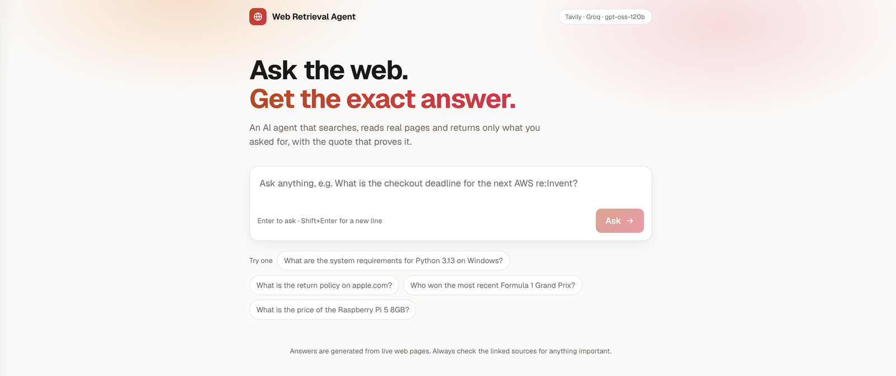
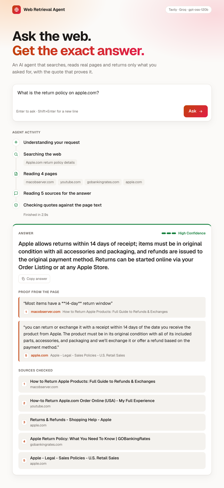
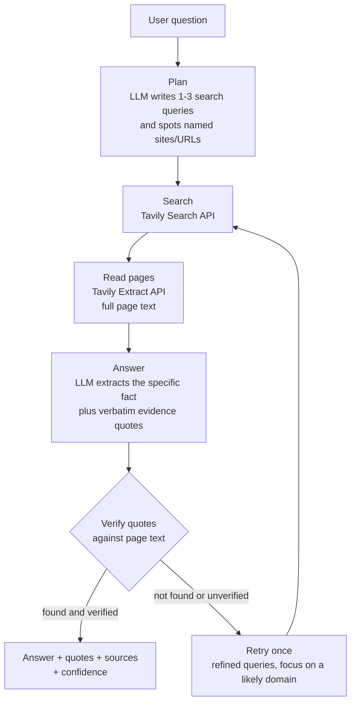

# Web Retrieval Agent

> Ask in plain English. An AI agent searches the web, reads the real pages and returns **only the specific information you asked for**, with the exact quote that proves it.

Built for the **AMD × lablab.ai AI Academy Challenge, Match 4: Intelligent Web Information Retrieval**.

**Live demo:** https://ai-web-retrival.vercel.app

## Screenshots

**Ask a question in plain English**



**Get the exact answer, the agent's steps, and the quotes that prove it**



## Why this is different from "ChatGPT with search"

Most search assistants write a fluent answer and hope it is right. This agent treats the model as untrusted:

- **Every answer must carry a quote** copied from a source page.
- **Quotes are verified in code.** The server checks each quote against the full text of the page it came from. Quotes the model made up or altered are dropped, and confidence is lowered when nothing verifies.
- **Unsupported figures are flagged.** If the answer states a number that none of the verified quotes contain, confidence is lowered and the UI tells you to check the sources.
- **"Not found" is a valid answer.** If the sources don't contain the information, the agent says so and does not guess.
- **Official sources win.** The prompt and ranking favour primary sources (a product's own site, official documentation) over blogs and aggregators.
- **You can watch it work.** Every step (planning, searching, reading, verifying, retrying) streams to the UI as it happens.

## How it works



1. **Plan.** The LLM turns the request into short, specific search queries. If you name a site or paste a URL, that page is read directly.
2. **Search.** Queries run in parallel on Tavily. Results are de-duplicated.
3. **Read.** The best pages are fetched in full. Pages are trimmed to the paragraphs most relevant to the question so they fit the model's context.
4. **Answer.** The LLM returns JSON: the answer, a confidence level and evidence quotes. It is told to use only the sources and to treat page text as untrusted data, which defends against prompt injection from web pages.
5. **Verify.** Quotes are normalised and matched against the page text. Unverified quotes are removed.
6. **Retry.** If the answer wasn't found or couldn't be verified, the agent searches again once with refined queries, optionally restricted to one domain.

The model declining a request (for example a request for a private person's address) is handled and shown as a clean message.

## Example results

Observed while developing and testing the agent:

| Question | Result |
| --- | --- |
| What are the system requirements for Python 3.13 on Windows? | Supported Windows versions, quoted from official Python pages (exact wording varies run to run) |
| What is the return policy on apple.com? | 14-day return window, quoted from apple.com's sales policy page |
| On python.org/downloads, what is the latest Python 3 release listed? | Version number quoted from the page that was named |
| What is the current price of an RC crawler? (vague on purpose) | A price range with named examples, not one arbitrary product |
| Founding year of a made-up company | "Couldn't find it", with no invented answer |

Results depend on live web content, so answers can change over time.

## Tech stack

| Layer | Choice |
| --- | --- |
| Framework | Next.js 16 (App Router), React 19, TypeScript |
| Web search and page reading | [Tavily](https://tavily.com) Search and Extract APIs |
| LLM | `openai/gpt-oss-120b` served by [Groq](https://groq.com), through an OpenAI-compatible client |
| Streaming | Newline-delimited JSON over a streaming `fetch` response |
| Hosting | Vercel |

**Model-agnostic by design.** `lib/llm.ts` talks to any OpenAI-compatible `/chat/completions` endpoint. Setting `LLM_BASE_URL` (and `LLM_API_KEY` / `GROQ_MODEL`) points the agent at another provider, for example an open model served with vLLM on an AMD GPU (ROCm), with no other code changes. The current deployment uses Groq.

## Getting started

Requirements: Node.js 20+ and API keys for [Tavily](https://tavily.com) and [Groq](https://console.groq.com).

```bash
git clone https://github.com/Xdiad47/AIWebRetrival.git
cd AIWebRetrival
npm install
cp .env.example .env.local   # then fill in your keys
npm run dev                  # http://localhost:3000
```

### Environment variables

| Variable | Required | Purpose |
| --- | --- | --- |
| `TAVILY_API_KEY` | yes | Web search and page extraction |
| `GROQ_API_KEY` | yes | LLM access (or set `LLM_API_KEY`) |
| `GROQ_MODEL` | no | Model id, default `openai/gpt-oss-120b` |
| `LLM_BASE_URL` | no | Any OpenAI-compatible endpoint, default Groq |
| `LLM_REASONING_EFFORT` | no | `low` / `medium` / `high` for reasoning models |
| `RATE_LIMIT_PER_10_MIN` | no | Requests per IP per 10 minutes, default 15 |
| `DEBUG_AGENT` | no | Set to `1` to log which sources reach the model |

### Scripts

```bash
npm run dev        # development server
npm run build      # production build
npm run typecheck  # TypeScript check
npm run lint       # ESLint
npm run models     # list models available to your key
```

### Call the API directly

```bash
curl -N -X POST localhost:3000/api/ask \
  -H 'content-type: application/json' \
  -d '{"question":"What are the system requirements for Python 3.13 on Windows?"}'
```

The response streams one JSON object per line: `step` events as the agent works, then a final `result` (or `error`).

## Project structure

```
app/
  page.tsx            UI: question box, live activity timeline, answer card
  api/ask/route.ts    streaming endpoint, input validation, rate limiting
lib/
  agent.ts            the agent loop: plan, search, read, answer, verify, retry
  tavily.ts           Tavily Search and Extract client
  llm.ts              OpenAI-compatible LLM client with retries and JSON handling
  text.ts             keyword extraction, relevant-excerpt selection, quote matching
  rate-limit.ts       best-effort per-IP limiter
scripts/
  list-models.mjs     lists the models your key can use
```

## Deploy on Vercel

1. Import the GitHub repo at [vercel.com/new](https://vercel.com/new). The Next.js preset is detected automatically.
2. Add `TAVILY_API_KEY`, `GROQ_API_KEY` and `GROQ_MODEL` under **Environment Variables**.
3. Deploy. The agent route sets `maxDuration = 60`; check your plan's function time limit.

API keys stay on the server. They are never sent to the browser.

## Limitations

- Answers come from what Tavily can fetch. Pages that need a full browser to render (heavy JavaScript, logins, paywalls) may not be readable.
- Search results change between runs, so the same question can return slightly different sources.
- The free Groq tier has a tokens-per-minute cap; very rapid repeat questions may be slowed or rate-limited.
- The rate limiter is in-memory, so on serverless hosting it is a speed bump, not a guarantee.
- Verification confirms a quote exists in the cited page. It does not prove the page itself is correct.

## Roadmap

- Follow links inside a site (multi-hop navigation) when the answer is on a sub-page.
- A headless-browser fallback for JavaScript-only pages.
- An evaluation set with measured accuracy and latency.
- Running the LLM on AMD GPU infrastructure with an open model.
